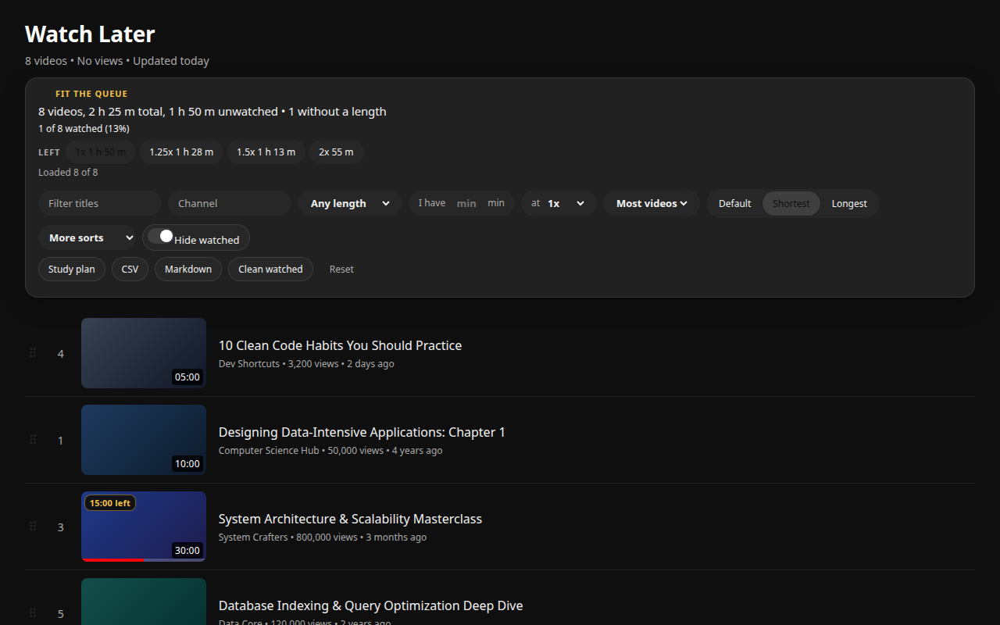
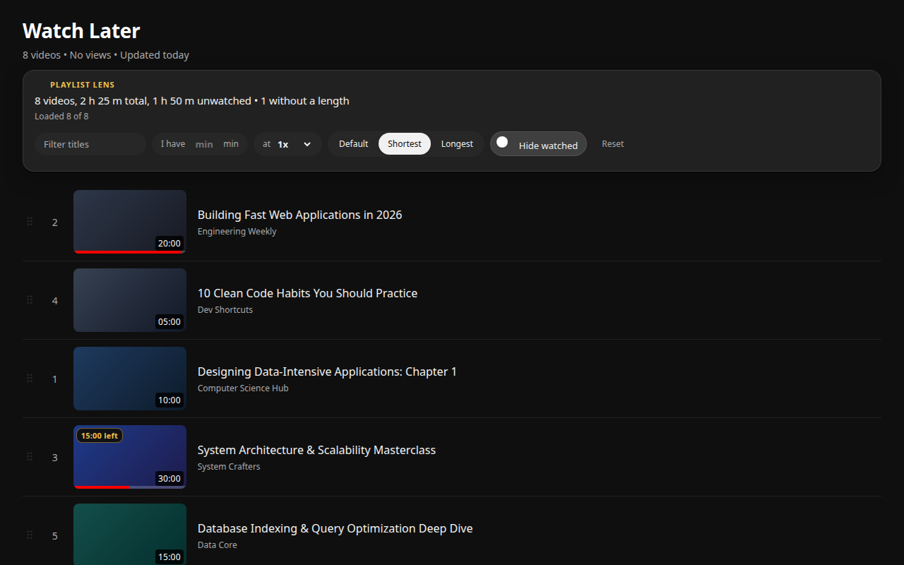

# Fit the Queue

**See how long a YouTube playlist really takes, and what fits in the time you have.** Total and remaining time at 1x–2x, sort and filter, pack a minute budget, export, and split a course across days. Private, offline, no analytics.

Formerly **Playlist Lens**. The storage key is unchanged, so version 2 keeps your settings.

[](https://chromewebstore.google.com/detail/olpginhinkaacjcfncphknhnmignoimo)
[](https://github.com/cig13zs/playlist-lens/actions)
[](LICENSE)
[](https://ko-fi.com/jju1s)

## Install

**[Fit the Queue on the Chrome Web Store](https://chromewebstore.google.com/detail/olpginhinkaacjcfncphknhnmignoimo)** — works in Chrome, Edge, and Brave. Store title and description: [STORE_LISTING.md](STORE_LISTING.md).

## Features

- **Speed row** — Time still left at 1x, 1.25x, 1.5x, and 2x, together. Partial watches count only the remainder.
- **Time budget** — Enter the minutes you have. **Most videos** keeps the shortest ones that fit. **Fill the time** packs the set that uses the most of those minutes. A video longer than the budget is left out, not cut short.
- **Sort and filter** — YouTube order, shortest, longest, newest, oldest, most or least viewed, or channel A–Z. Filter titles and channel names (`lecture -shorts`), and keep videos under 10 minutes, 10–30, or over 30, by time still left.
- **Watched progress** — “3 of 40 watched” on the bar. The popup remembers the last 30 playlists on this device (title, counts, time left). Options can forget them. They are not synced.
- **Study plan** — Split what is left, in playlist order, across the days and daily minutes you choose. Download it as Markdown.
- **Export** — CSV of the loaded rows, or Markdown of the visible ones. The file stays on your device.
- **Watch Later cleanup** — Lists watched videos. Nothing is removed until you press Remove. Each click uses YouTube’s own “Remove from Watch Later” item, and the batch stops if that item is missing. Other playlists do not show it.
- **Hide watched, Load all, Reset** — Watched means a 90%+ progress bar. Load all scrolls until YouTube stops or 2,000 videos, and says “Loaded N of M” when the list is only partly loaded.
- **Layout fallbacks** — Durations are read from the badge, then from an accessible name (“12 minutes, 4 seconds”). If most lengths cannot be read, the bar says the totals are partial instead of inventing them.







## Permissions

| Permission | Why |
|------------|-----|
| `storage` | Remember your budget, sort, hide-watched, speed, pack mode, study defaults, and dismissed cards. Uses `chrome.storage.local` and, for those settings, `chrome.storage.sync` across signed-in Chrome browsers. Playlist progress stays in local storage only. No data is sent to Fit the Queue servers — there are none. |

**Host access:** The extension only injects a content script on `https://www.youtube.com/*` (declared in `content_scripts.matches`). It does not request broad `<all_urls>` access.

## Privacy

No account, no analytics, no extension-initiated network requests. Title and channel filters stay in memory for that playlist and are not saved. Ko-fi and Web Store rating links open only when you click them. Details: [PRIVACY.md](PRIVACY.md).

## Build and test

Requirements: **Node.js 20+**.

```bash
npm ci
npm run verify          # lint + unit tests + build (zip artifacts in dist/)
npm test                # unit tests only (src/lib/lens.js)
npm run build           # dist/chrome, dist/firefox, and versioned .zip files
npx playwright install chromium   # first time only, for e2e
PLAYLIST_LENS_OFFLINE=1 npm run e2e   # Playwright smoke tests + screenshots
```

Optional real-playlist e2e (needs network): `npm run e2e` without `PLAYLIST_LENS_OFFLINE=1`. Fixtures `tests/fixtures/playlist-under-100.html` and `playlist-over-100.html` are optional local saves of public playlists.

Load unpacked: `chrome://extensions` → Developer mode → **Load unpacked** → `dist/chrome`.

When YouTube changes layout, update selectors in [`src/selectors.js`](src/selectors.js). The bar reports a partial total when fewer than half of the loaded rows have a length.

## Changelog

See [CHANGELOG.md](CHANGELOG.md).

## Contributing

Issues and PRs are welcome. See [CONTRIBUTING.md](CONTRIBUTING.md). Security reports: [SECURITY.md](SECURITY.md) (private advisory, not public issues).

## License

MIT — see [LICENSE](LICENSE). Unofficial; not affiliated with YouTube or Google LLC.

## More tools by the same author

Other projects from [cig13zs on GitHub](https://github.com/cig13zs).