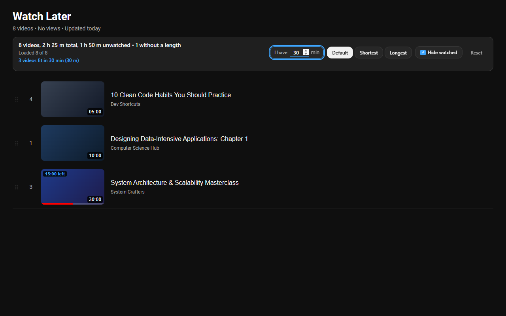

# Playlist Lens

A browser extension that adds a bar above any YouTube playlist, Watch Later and Liked videos included, and answers one question: what can I watch in the time I have?

Type the minutes you have and only the videos that fit stay on screen, shortest first, with a running total ("3 videos fit in 30 min"). A video longer than the budget is left out rather than cut short.

The bar also shows the playlist's video count, total runtime and unwatched runtime. Videos YouTube marks as watched (progress bar at 90% or more) are hidden by default, and partly watched ones count only the time they have left.

YouTube loads long playlists 100 videos at a time, so the bar says how many it has ("Loaded 100 of 312") and marks a sort that only covers part of the list. Load all scrolls the list for you, up to 2,000 videos.

Rows are reordered and hidden in place, so YouTube's own thumbnails, menus and links keep working. Drag-to-reorder is turned off while a sort is on, so you can't save an accidental reorder of your own playlist. Reset puts everything back.

## Install

Get it from the [Chrome Web Store](https://chromewebstore.google.com/detail/olpginhinkaacjcfncphknhnmignoimo). It works in Chrome, Edge and Brave.

To build it yourself, or for Firefox:

1. Clone this repo and run `node build.mjs` (Node 20 or newer, no dependencies).
2. Open `chrome://extensions`, turn on Developer mode, click Load unpacked and pick `dist/chrome`.

For Firefox, open `about:debugging#/runtime/this-firefox`, click Load Temporary Add-on and pick `dist/firefox/manifest.json`.

## Privacy

No account, no analytics and no network requests of its own. It asks for one permission, `storage`, to remember your budget, sort and hide-watched setting on your device. Full policy: [PRIVACY.md](PRIVACY.md).

## Development

`node --test tests/` runs the unit tests for the parsers in `src/lib/`. `tests/e2e.mjs` loads the extension in Playwright against saved playlist pages; it expects `playlist-under-100.html` and `playlist-over-100.html` in `tests/fixtures/`, which aren't committed because they are copies of other people's playlists. Save any two public playlists there after the page has loaded.

When YouTube changes its layout, the fix usually goes in `src/selectors.js`.

Unofficial, not affiliated with YouTube. MIT licence.
