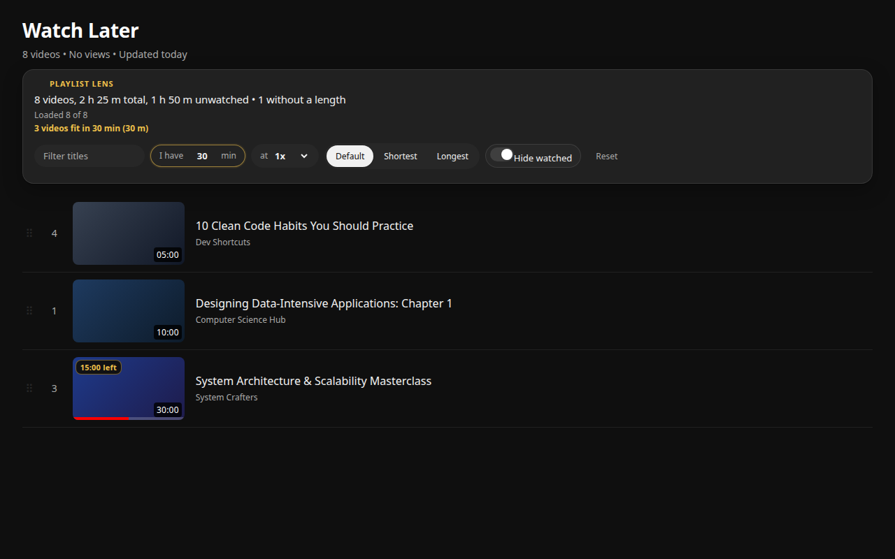
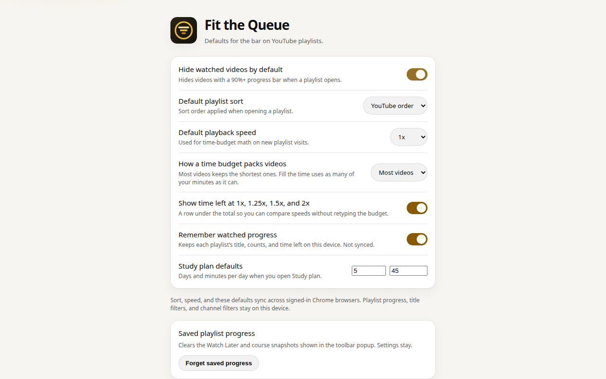

# Playlist Lens

**Fit YouTube playlists into the time you actually have** — sort by duration, hide watched videos, filter titles, and see honest unwatched totals. Private, offline, no analytics.

[](https://chromewebstore.google.com/detail/olpginhinkaacjcfncphknhnmignoimo)
[](https://github.com/cig13zs/playlist-lens/actions)
[](LICENSE)
[](https://ko-fi.com/jju1s)

## Install

**[Playlist Lens on the Chrome Web Store](https://chromewebstore.google.com/detail/olpginhinkaacjcfncphknhnmignoimo)** — works in Chrome, Edge, and Brave.

## Features

- **Time budget** — Enter minutes you have; only videos that fit stay visible, shortest first, with a running total (e.g. “3 videos fit in 30 min”). A single video longer than the budget is excluded, not truncated.
- **Title filter** — Keep videos whose titles contain every word you type; prefix a word with `-` to exclude it (e.g. `lecture -shorts`). Works with the time budget.
- **Playback speed** — Set 1x–2x next to the minutes box. At 1.5x, 30 minutes holds 45 minutes of video; totals reflect watch time at that speed.
- **Runtime header** — Video count, total runtime, unwatched runtime, and count of items without a length (live, premiere, etc.).
- **Hide watched** — Videos with ≥90% watch progress are hidden by default; partial watches count remaining time only.
- **Sort** — Default YouTube order, shortest first, or longest first (in-page reorder via CSS; drag-to-reorder is disabled while sorting/filtering).
- **Load all** — Scrolls long playlists until YouTube stops loading or 2,000 videos, with honest “Loaded N of M” messaging.
- **Reset** — Restores native order, visibility, and controls.






## Permissions

| Permission | Why |
|------------|-----|
| `storage` | Remember your budget, sort, hide-watched, speed, and dismissed cards on your device. Uses `chrome.storage.local` and, for defaults, `chrome.storage.sync` across signed-in Chrome browsers. No data is sent to Playlist Lens servers — there are none. |

**Host access:** The extension only injects a content script on `https://www.youtube.com/*` (declared in `content_scripts.matches`). It does not request broad `<all_urls>` access.

## Privacy

No account, no analytics, no extension-initiated network requests. Filter-by-title text stays in memory on the page and is not saved. Ko-fi and Web Store rating links open only when you click them. Details: [PRIVACY.md](PRIVACY.md).

## Build and test

Requirements: **Node.js 20+**.

```bash
npm ci
npm run verify          # lint + unit tests + build (zip artifacts in dist/)
npm test                # unit tests only (src/lib/lens.js)
npm run build           # dist/chrome, dist/firefox, and versioned .zip files
npx playwright install chromium   # first time only, for e2e
PLAYLIST_LENS_OFFLINE=1 npm run e2e   # Playwright smoke tests + screenshots
```

Optional real-playlist e2e (needs network): `npm run e2e` without `PLAYLIST_LENS_OFFLINE=1`. Fixtures `tests/fixtures/playlist-under-100.html` and `playlist-over-100.html` are optional local saves of public playlists.

Load unpacked: `chrome://extensions` → Developer mode → **Load unpacked** → `dist/chrome`.

When YouTube changes layout, update selectors in [`src/selectors.js`](src/selectors.js).

## Changelog

See [CHANGELOG.md](CHANGELOG.md).

## Contributing

Issues and PRs are welcome. See [CONTRIBUTING.md](CONTRIBUTING.md). Security reports: [SECURITY.md](SECURITY.md) (private advisory, not public issues).

## License

MIT — see [LICENSE](LICENSE). Unofficial; not affiliated with YouTube or Google LLC.

## More tools by the same author

Other projects from [cig13zs on GitHub](https://github.com/cig13zs).